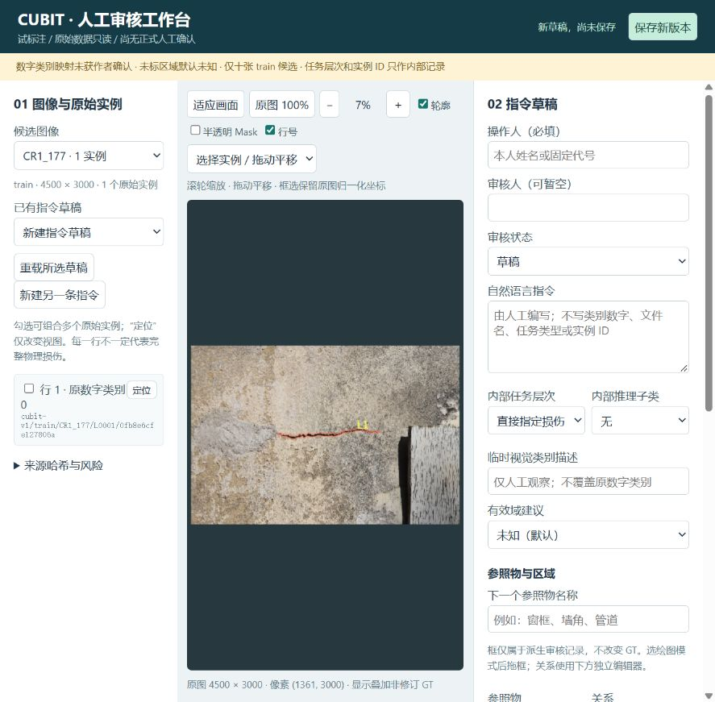

# CUBIT-TEXT-PILOT-01 验收报告

日期：2026-10-29（北京时间）。执行完成，等待 ChatGPT Supervisor 审核；**人工确认 0、正式训练样本 0、训练调用 0**。

## 可直接使用的入口

双击 [start_review.cmd](../../../research/cubit_text_pilot/start_review.cmd)，本地浏览器地址为 `http://127.0.0.1:8765`。当前十图用户工作台已启动，操作人、指令和目标集合为空，工程测试记录没有混入。关闭浏览器不会删除草稿，也不会停止本地服务。

[简明操作说明](../../../research/cubit_text_pilot/README.md) · [十图待审核问题清单](CANDIDATE_REVIEW.md) · [规范修订草案 v0.2](ANNOTATION_DRAFT_V02.md) · [记录结构示例](record_structure.example.json) · [独立复查](review/INDEPENDENT_REVIEW.md)

界面截图仅展示工具入口，不代表已完成标注：

## 已完成

- 使用原生 HTML/CSS/JavaScript Canvas 和 Python 标准库本机 HTTP 服务；沿用现有 P1A Python，无前端框架、云服务、模型调用、数据库或新依赖安装。
- 原分辨率照片按原始 JPEG 字节提供；缩放/拖动平移、适应画面、100% 视图，轮廓/半透明 Mask/行号独立开关。实例列表显示稳定 ID、原行号、原数字类别，可定位并选择多个实例。
- 人工填写/修改指令，保存多个独立指令草稿；可绘制参照物框、建议有效域和未知区域，记录与当前目标集合的关系及证据。bbox使用原图归一化坐标，不改变原多边形。实例碎片、漏标、遮挡、截断、唯一性与空间关系问题可标记并补充备注。
- 每版 JSON 包含源图/标签哈希、目标集合、内部层次、操作人/审核人/状态、UTC时间及历史哈希链；不可覆盖发布，过期版本冲突拒绝，重新加载继续编辑。正式用户 `drafts` 与 `qa_drafts` 隔离，并默认不提交Git。
- 内部层次保留直接/位置/推理，推理再分视觉语义与空间关系；不自动拼入自然语言。服务器拒绝常见内部ID/类别/任务字段泄漏，但人工仍须审核自由文本的语义。
- 严格按顺序：先四图工程与实际浏览器保存/重载门禁，通过后才准备其余六图。十图均来自给定上一阶段候选表，原图/标签哈希匹配，共33原实例，稳定ID和坐标未变。只访问指定train图像内容。
- 逐图查看原多边形概览及原像素局部，记录风险和可尝试描述方向，未填写正式指令或修改GT。细部可辨性、物理损伤完整性、组合依据及关系唯一性均待人核验。

## 实际验证

|检查|结果与证据|
|---|---|
|首四图工程门禁|12项测试通过，涵盖四真实源记录往返、版本冲突/历史、多目标几何、异图ID/越界/未知路径/正式确认状态/内部泄漏拒绝；见 four_engineering_tests.txt，最终复跑 final_engineering_tests.txt|
|首四图浏览器操作|四图实际打开、勾选实例、编辑测试占位文字、保存及重载均观察成功；还验证定位、100%与Mask开关。SP0_794第二版保存/重载了两个目标、一个手绘测试参照框和一条测试关系。见 four_gate.json、ui_results.json、source_protection.json|
|其余六图界面|逐张加载成功，原尺寸及实例行数3/4/8/3/7/2匹配；见 ui_results.json。未向用户草稿区保存内容|
|独立工程/API检查|31项通过；新增元数据阻断与会话身份10项通过；入口7项分支mock通过。见 review/engineering_results.json、delta_results.json、launcher_results.json。独立代理未操作GUI，不把执行者浏览器观察称为独立GUI证明|
|十图来源与几何|独立重算原图/标签SHA、33行ID与完整坐标、原尺寸、Decimal非零有向面积及历史重复候选隔离，全部通过；见 review/ten_source_results.json。非零面积不保证无自交或无碎片|
|保护检查|最终20源文件哈希匹配，大小/mtime与准备记录一致，用户草稿为空；见 source_protection.json。没有改写旧科研源码/报告、RC1、V3、环境或CodeArts Space|

浏览器检查是执行者证据。鼠标绘制坐标经过实际保存重载核对；未做浏览器全组合压力测试、完整断电实验、每像素边缘验收或多人人工一致率实验。独立报告及工程通过均不能代替科学正确性/正式标注验收。

## 失败、修复和检查限制

- 首次受限服务无法从浏览器连接，本机套接字被限制；以正常权限启动后正常使用，没有改系统网络设置或ACL。
- 首轮受限工程测试中3项原子硬链接发布因权限拒绝失败，保留 four_engineering_tests_restricted_failure.txt；以正常权限重试12项全通过。没有把失败日志改写为成功。
- 独立复查促成三处早期修复：限制草稿目录，最终revision写入改为flush/fsync后非覆盖原子发布，保存/重载等待时锁定界面避免异步响应覆盖。
- 独立启动器mock首次发现新启动分支可能错误复用另一个数据/QA服务，2项失败证据在 review/launcher_results_initial_failure.json。补入共同会话身份校验后7项通过；检查数据哈希与正确用户draft目录后才写PID/打开浏览器。
- 标注人/审核人是本机自报身份，无账户认证。修改历史不是外部认证审计；部分来源不匹配会拒绝；当前不验证完整历史哈希链，不能保证手工改写可检测，也没有防篡改身份保证。异常断电恢复只做发布前注入失败检查，没有过度保证。
- 当前参照物和域只提供矩形框，可多个组合，复杂轮廓可备注；不提供参照物多边形编辑、正式训练Mask生成或训练集导出。

## 保留的问题与未完成事项

人工逐实例检查、无GT盲读目标唯一性、双人审核、有效域认定和正式指令编写均未由执行者代做。未把“待人工审核”当“已确认”。逐图风险清单为待核观察，不是正式标注或已证实的漏标结论。

13条零有向面积异常保持原记录。历史222组跨划分是CRC32+大小候选，只有两组可定位SHA完整证据，未升级证明。原class0/1权威映射未确认；未标区域不能作负样本；原实例可碎片化；建筑/航线分组未知。十图排除历史重复候选不证明跨建筑独立。P1A正式训练仍停止，不自动恢复。

## Git与停止状态

启动实核分支 research/cubit-text-prep-20261029、HEAD `4b9cc90c39a9d6375f81445935ad2bc7d3dc4318`，工作树干净，远端一致。新任务分支 `codex/cubit-text-pilot-01-20261029`，首个工具/门禁检查点 `c6f7bf7` 已推送。最终只新增 research/cubit_text_pilot 与本报告目录，并更新两份handoff；不改既有报告。原图和本地较大派生PNG/QA草稿不提交，十图坐标/来源manifest保留供离线追溯。

任务到此停止，交Supervisor审核。正常用户工具空白待用；工程测试服务另行关闭。不得自动进入正式文本生成、扩大候选、批量标注、导出、训练、垂域微调或LISA。
